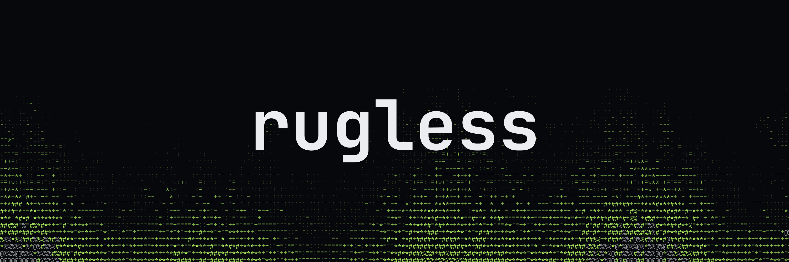
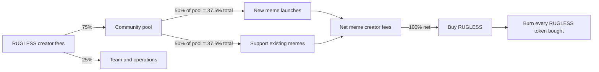

<p align="center"></p>

<h1 align="center">The end of the rug.</h1>
<p align="center">Your memes. Your community. Proof you can follow.</p>
<p align="center">
  <a href="https://github.com/RuglessFun/rugless-app/actions/workflows/ci.yml"></a>
  <a href="LICENSE"></a>
  <a href="CONTRIBUTING.md"></a>
</p>

Rugless is an open-source Solana meme discovery and trading app. Find the story behind a token, inspect a real market chart, and review a swap through your own wallet. The wider project turns community nominations into transparent, explainable launches and uses creator fees to support communities and buy back RUGLESS.

**Read the code. Question the assumptions. Help us build it.**

## What you can run today

- **Market discovery:** five real, externally launched Pump tokens with live price, market cap, 24h change, volume and liquidity. Search, clickable trending cards, and a local watchlist.
- **Token pages:** TradingView Lightweight Charts using real PumpSwap OHLCV, selectable intervals, contract copying, pool provenance and Pump.fun links.
- **Wallet-connected swaps:** Jupiter's integrated trade form with editable amounts, quotes and wallet approval through Solana Wallet Adapter / Wallet Standard. No custodial keys or automatic signing.
- **Rugless website:** ASCII fire, nomination example, animated fee flow, illustrative rug-pull chart and an interactive buyback model using a current SOL quote.
- **Public roadmap:** five phases, small acceptance-driven milestones, separate code/staging/production states, and links to contribute.

The current market list includes **Nothing, REMUS, XD, Kimchi and CHICO**, selected on October 27, 2026 for recent PumpSwap activity. They are **external market examples, not Rugless launches or investment recommendations**. Selection reasons and exact pool addresses live in [`src/data/tokens.json`](src/data/tokens.json). Market values are fetched, not hard-coded. Missing market caps remain missing; FDV is never relabeled as market cap.

X ingestion, AI launch execution, rewards, treasury buybacks and production deployment are **not implemented by this frontend**. The feed and receipt views have honest empty states. No fake posts, nominators, AI launch theses or mainnet receipts are inserted. Existing roadmap milestones remain planned unless evidence supports another state.

## Run locally

Requires Node.js 24 and npm.

```sh
git clone https://github.com/RuglessFun/rugless-app.git
cd rugless-app
nvm use
npm ci
cp .env.example .env.local
npm run dev
```

Open **http://localhost:3000** for the website or **http://localhost:3000/app** for the application.

No API key is needed for local public market data. A production RPC provider is recommended for reliable wallet balances and transaction submission. `NEXT_PUBLIC_SOLANA_RPC_URL` is browser-visible: use an origin-restricted browser endpoint, never a private server credential. `NEXT_PUBLIC_SITE_URL` controls social metadata URLs.

```sh
npm run typecheck
npm test
npm run format:check
npm run build
npm start
```

## Architecture

```text
src/
  app/                    Next.js App Router pages and API routes
    api/markets/          Shared cached market snapshot
    api/sol-price/        Current SOL/USD quote
    api/tokens/[mint]/    Curated-pool candle endpoint
    app/                  Discovery, tokens, watchlist, feed, receipts
    roadmap/              One public roadmap
  components/             Typed React UI, charts, wallet, ASCII fire
    ui/                   shadcn sidebar and Radix-based primitives
  data/                   Reviewed token registry and roadmap milestones
  hooks/                  Market refresh and local watchlist
  lib/                    Validation, formatting and projection model
    server/               Server-only external market access
scripts/                  Community review policy and GitHub check runner
```

**Stack:** Next.js 16, React 19, strict TypeScript, Tailwind CSS 4, shadcn/ui, Solana Wallet Adapter, Jupiter Plugin, TradingView Lightweight Charts, Zod and Vitest.

Market requests run through server endpoints, validate the exact token/pool relationship and use a shared 60-second cache. Candles are cached for 30 seconds. Visible clients refresh every 60 seconds; hidden pages stop scheduled refreshes. This is HTTP polling, not a websocket stream. The X API is never called by this app. See [integration details](docs/INTEGRATIONS.md).

### Trading boundary

The Jupiter form is a real mainnet integration. It can request quotes and ask a connected wallet to approve a transaction. It is **not** a simulated order panel. The app never receives private keys. Wallet connections require user interaction; no funded-wallet trade is part of automated verification.

The hosted Jupiter script is third-party executable code and can update independently of this repository. Review that dependency and provider availability before production; see [security policy](SECURITY.md). A visible form is not proof that any particular token always has an executable route.

## Follow the funds



These are allocations of **captured creator fees**, not trading volume. Support prioritizes social activity over volume. The frontend describes the intended mechanism; it does not implement treasury execution. The buyback calculator is an illustrative cohort model, not a price or return forecast.

## Contribute and review

See [CONTRIBUTING.md](CONTRIBUTING.md). Core PRs need at least **72 hours of community review for their latest code commit**, passing CI, approval and resolved blocking feedback. The review check uses a GitHub-recorded timestamp rather than an author-controlled commit date. A new commit gets a new clock. Only allowlisted Markdown and raster content can bypass the waiting period.

Code merged, staging verified and production deployed are separate states. **There is no automatic production deployment in this repository.** The initial repository bootstrap is not evidence of a completed community review or a mainnet launch. See [release process](docs/RELEASES.md).

## Deploy

Deploy as a **Next.js Node application**, not a static export: the market endpoints require a server.

1. Import `RuglessFun/rugless-app` into your Next.js-compatible host (for example, Vercel).
2. Set the two documented environment variables for each environment.
3. Enable PR previews/staging, but disable automatic production publication.
4. Use the reviewed release procedure before promoting the exact tested commit.

For self-hosting, run `npm ci && npm run build`, then `npm start` behind your HTTPS reverse proxy. The default script binds to loopback; adjust the hostname in your deployment command for container networking. Configure shared durable caching/rate limiting when scaling across processes or regions.

## Assets and licenses

Application code: [MIT](LICENSE). shadcn/ui attribution: [SHADCN-LICENSE](docs/SHADCN-LICENSE.md). Lightweight Charts retains its TradingView attribution in the chart UI. JetBrains Mono is distributed under the SIL Open Font License; see [font license](public/fonts/OFL.txt).

Rugless artwork is included for this project; the MIT code license does not grant trademark rights. External token images are fetched from their metadata providers and remain their owners' material. The nomination example links to Elon Musk's original X post; it implies no affiliation or endorsement. See [asset notes](docs/ASSETS.md).

**Virtual assets are highly volatile. You can lose everything invested. Burns, buybacks, AI selection and open-source code do not guarantee safety, liquidity or returns.**
